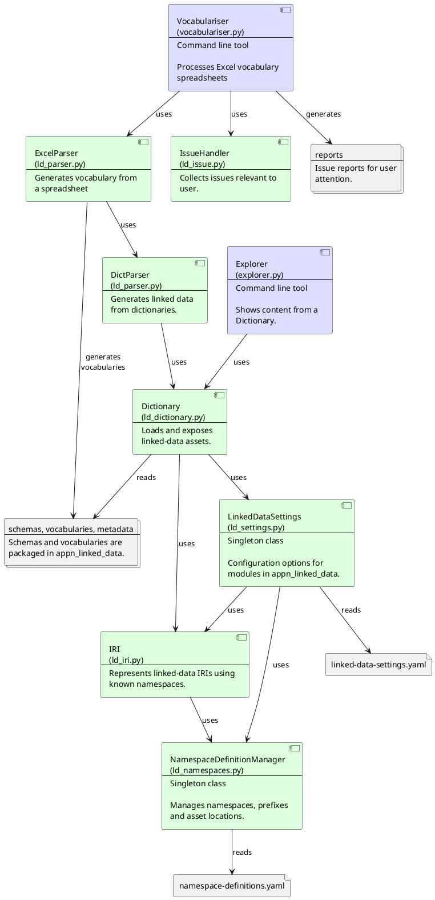

# appn-linked-data - APPN linked data tools

This repository provides the linked-data tools used across the Australian Plant
Phenotyping Network ([APPN](https://[plantphenomics.org.au/])), including:

* Schema definitions for APPN data
* Vocabularies containing reusable definitions for APPN facilities, equipment and concepts
* Python tools to create, manipulate and query linked-data assets

## Status

**Active** — maintained by **APPN Central Data Team**.
Contact: **data.appn@plantphenomics.org.au**

## Install

Requires **Python 3.12**.

```bash
git clone https://github.com/aus-plant-phenomics-network/appn-linked-data.git
cd appn-linked-data
make install
```

## Run



`appn_linked_data` includes the following components:

* **NamespaceDefinitionManager**: Singleton to load and manage namespace definitions for all components.
* **IRI**: Class to represent an IRI/URI and offer quick access to parts and to CURIE representations, subclass of `rdflib.URIRef` and serves as a pydantic model.
* **LinkedDataSettings**: Singleton to supply configuration options for all other components - relies on `NamespaceDefinitionManager` and `IRI`.
* **Dictionary**: Class for loading sets of linked data assets (schemas, vocabularies and metadata) into an `rdflib.Graph` and providing helper functions for common queries.
* **DictParser**: Class for converting Python dictionaries or `pandas` `Series` into triples in an `rdflib.Graph`.
* **IssueHandler**: Class for collecting user-focused log messages for use in reports.
* **ExcelVocabularyParser**: Command-line interface (as `vocabulariser.py`) to generate a linked data vocabularies from Excel spreadsheets in `src/vocabulary_templates/`.
* **Explorer**: Command-line interface to explore a `Dictionary` instance.

Generate new copies of linked data vocabularies for APPN and for APPN nodes:

```bash
python vocabulariser.py
```

Explore the APPN schema and referenced schemas:

```bash
python explorer.py
```

Explore the APPN schema, referenced schemas and the APPN and Adelaide University vocabularies:

```bash
python explorer.py -a APPN -a AU
```

## Configure

Settings live in `config/config.yaml` (committed, no secrets). Any key can be
overridden from the environment as `APPN_LINKED_DATA__<SECTION>__<KEY>`;
secrets come from the environment only.

| Variable | Required | Default | Purpose |
|---|---|---|---|
| `APPN_LINKED_DATA__APP__LOG_LEVEL` | No | `INFO` | {{Logging verbosity}} |
| `APPN_LINKED_DATA__APP__LOG_FORMAT` | No | `json` | {{`json` for log aggregation, `text` for local reading}} |

## Test

```bash
make test
```

## Deploy

<!--
{{Deployment command, or a link to docs/runbook.md.}}
-->

## Licence and citation

Licensed under Apache-2.0 — see [LICENSE](LICENSE).

If you use this software in published work, please cite it using the metadata in
[CITATION.cff](CITATION.cff), or the "Cite this repository" button on GitHub.

---

<!--
  Sanity check before you delete this comment: could a new starter get this
  project running from this README alone, in under thirty minutes? If not, it is
  not finished (§3.2).
-->
